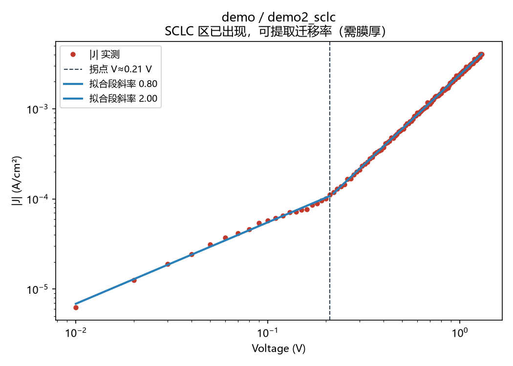
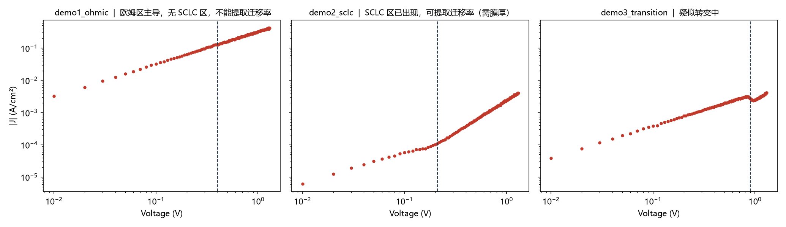
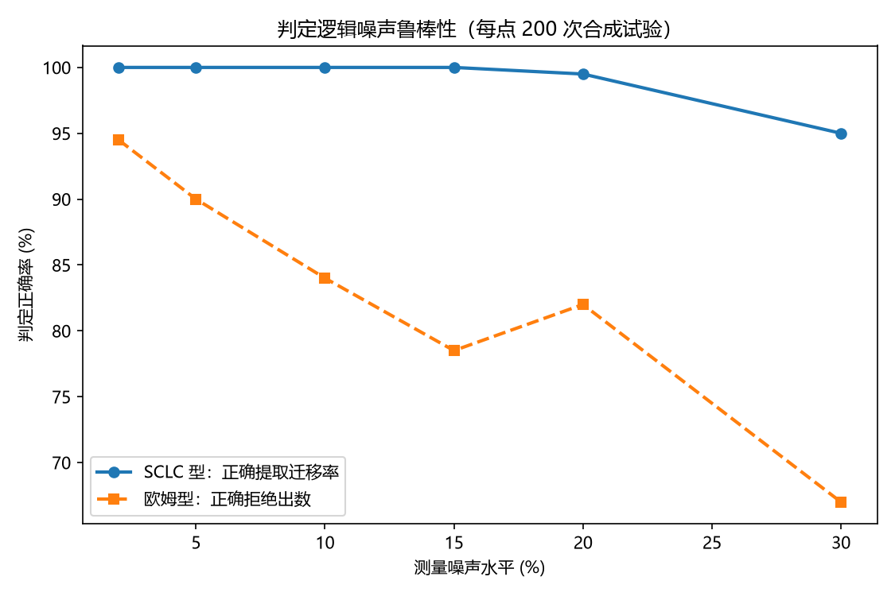

# 01 · SCLC 测量流水线（含数据标准化）

把源表（源表/Keithyley 类仪器）导出的暗态 J-V 文本数据一键变成
**分区判定报告 + 迁移率**：自动解析 → log-log 分区 → 拐点/V_TFL 检测 →
Mott-Gurney 迁移率（仅当判定进入 SCLC 区才输出，否则明确拒绝）。

对应整体项目中的 **项目 8（数据标准化）+ 项目 10（流水线）**。

## 快速开始

```bash
python make_demo_data.py     # 生成 3 个合成演示样品（data/demo/）
python sclc_pipeline.py      # 跑流水线，结果在 results/
```

三个演示样品分别展示三种判定：全程欧姆（拒绝给迁移率）、完整 SCLC 转变
（自动算出迁移率，反演值与真值误差 0.2%）、转变中（提示提高电压复测）。



红点=实测，蓝线=两段拟合（斜率 1→2），虚线=拐点；另两个样品的判定图见
`figs/`（欧姆拒绝 / 转变中提示复测）。每次运行还会自动生成全批次总览图：



## 用你自己的数据

1. 把仪器导出的文本文件放进 `data/raw/`（支持任意后缀，自动按内容识别；
   jpg/mia/txt 等附属文件自动跳过，重复文件按内容去重）
2. 在 `sclc_pipeline.py` 的 `CONFIG` 里把 `input_dirs` 改为 `["data/raw"]`
3. **在 `thickness_um_default` 或 `thickness_um` 表里填真实膜厚**
   （迁移率 ∝ 1/L³，膜厚必须准）
4. 重跑 `python sclc_pipeline.py`

数据文件格式要求见 `data/README.md`。

## 判定逻辑的噪声鲁棒性（基准）

`benchmark_robustness.py` 用真值已知的合成曲线量化判定可靠性
（每个点 200 次试验）：



- **SCLC 型样品**：15% 噪声内 100% 正确提取，30% 噪声仍有 95%
- **欧姆型样品**：2% 噪声下 94.5% 正确拒绝；30% 噪声时降到 67%——
  折线拟合会被噪声"骗"出假拐点

结论：仪器典型噪声（2–5%）下两种判定都可靠；重噪声下误报率上升，
所以**迁移率数字永远要对着 log-log 图人工复核一遍**——流水线的
判定图就是为了这一步而生。

## 判定逻辑

log(J)-log(V) 斜率：≈1 欧姆区 → ≈2 空间电荷限制区（SCLC），
两段之间的拐点即陷阱填充极限电压 V_TFL。

- 高压段斜率 ≥ 1.6：判 SCLC 区出现，对拐点后窗口做 J-V² 回归得 μ
- 1.3–1.6：判"疑似转变中"，建议提高扫描电压复测
- ≤ 1.3：判欧姆区主导，**拒绝报告迁移率**（宁可无数，不给错数）

## 依赖

numpy, pandas, matplotlib（见仓库根目录 requirements.txt）
